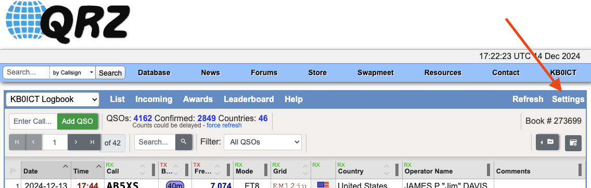
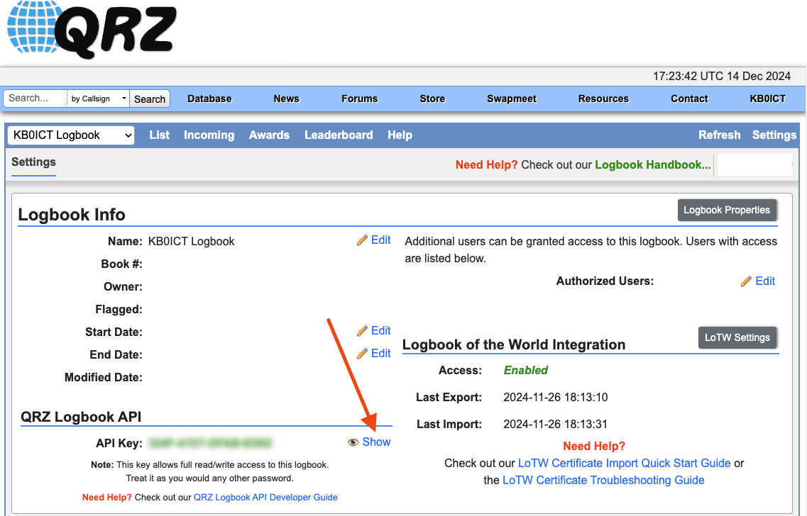
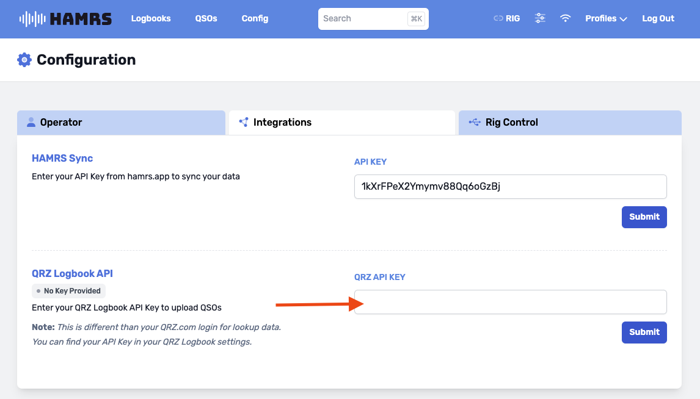

# QRZ Logbook API Key

:::info
The **QRZ Logbook API key** is for **uploading QSOs** from HAMRS to your QRZ Logbook. It requires a paid QRZ.com XML subscription.

It is not the credential used for **callsign lookups**. Lookups use your **QRZ.com username and password** instead. See [Callsign Lookups](/docs/integrations/lookups/callsign-lookups) to set those up, and the [Which credential is which](/docs/integrations/lookups/callsign-lookups#which-credential-is-which) table if you're not sure which one you need.
:::

## Finding your API Key on QRZ.com

### 1. Navigate to your Logbook Settings:

### 2. Click 'Show' to un-hide your API key:

### 3. Enter your API Key in HAMRS Config > Integrations:

Once the key is saved, you can [upload a logbook to QRZ](./uploading-logbooks).
