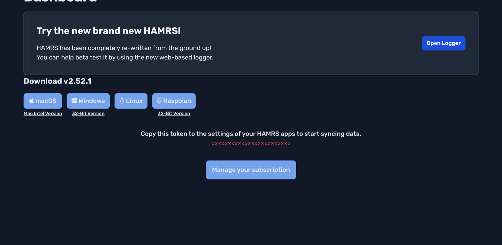
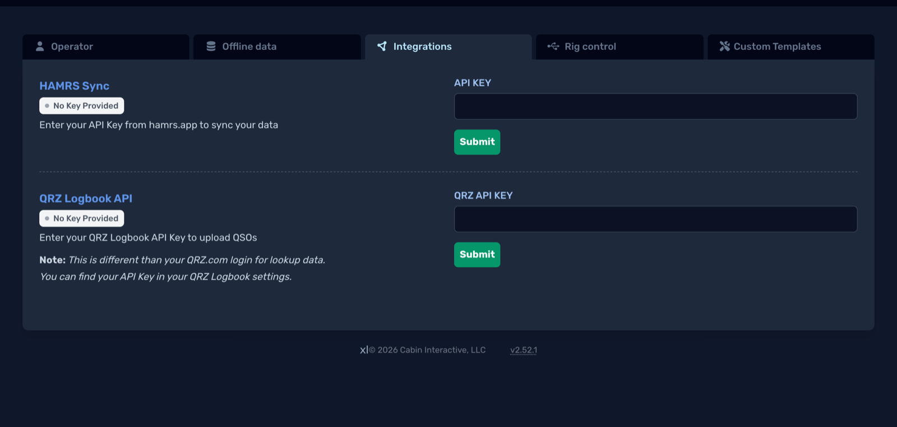
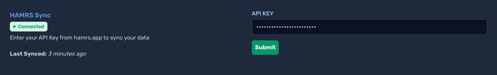
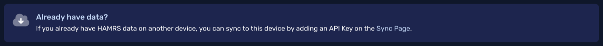

# Setting Up Sync

HAMRS Sync keeps your logbooks, QSOs, and operator profiles identical across every device you run HAMRS on. Log a contact on your phone in the field, and it's waiting for you on your desktop when you get home.

Setup happens in two places:

1. **hamrs.app** — your account lives here. This is where you subscribe and where your **API Key** comes from.
2. **Each HAMRS app** — desktop, mobile, and web. You paste the *same* API Key into every one of them.

:::info
HAMRS Sync requires an active **hamrs.app subscription**. If your subscription lapses, sync pauses until it's renewed. Your data stays on your devices in the meantime.
:::

## Part 1: Get your API Key from hamrs.app

### 1. Sign in to hamrs.app

Go to [hamrs.app](https://hamrs.app) and sign in, or create an account and subscribe if you haven't already.

### 2. Copy your API Key from the Dashboard

Once you're subscribed, your **Dashboard** shows your sync token:

> Copy this token to the settings of your HAMRS apps to start syncing data.

The token is created for you automatically the first time you visit the Dashboard with an active subscription, so there's nothing to generate by hand. Copy it. It's a long string of letters and numbers and you'll need to paste it into each app in Part 2.

:::tip
You can also view, rename, or revoke your keys under **Account > Sync** on hamrs.app. If you ever think your key has been exposed, revoke it there and create a new one. You'll then need to update the key in each of your apps.
:::

## Part 2: Add the API Key to each HAMRS app

Repeat these steps on **every device** you want to sync. They all use the same key.

### 1. Open Config

Click **Config** in the top navigation bar.

### 2. Go to the Integrations tab

### 3. Paste your API Key into the HAMRS Sync section

Paste the key from hamrs.app into the **API Key** field and click **Submit**.

### 4. Check the status badge

The badge next to **HAMRS Sync** tells you where you stand:

| Badge | Meaning |
| --- | --- |
| **No Key Provided** | No API Key has been entered yet. |
| **Connected** | Sync is working. A **Last Synced** time appears below the badge. |
| **Errored** | HAMRS couldn't sync. The error message explains why (see Troubleshooting below). |

That's it for this device. Move on to the next one and repeat Part 2.

:::tip Setting up a brand new device?
On a fresh install, the **First Time Setup** screen has an **Already have data?** notice with a link to the **Sync Page**. That page is just the API Key field on its own. Paste your key there and your profiles and logbooks will be pulled down before you create anything new.

:::

## Using the web logger

If you open HAMRS in your browser from the **Open Logger** button on your hamrs.app Dashboard, the web logger is signed in with your key automatically. You don't need to paste anything.

## How sync works

Once a key is in place, HAMRS syncs continuously in the background whenever it has an internet connection. There's no button to press.

- **First sync on a new device** pulls down everything from your account before the app finishes starting up. On a large logbook this can take a minute.
- **While you're offline**, HAMRS keeps logging to the device as normal. Changes are pushed the next time you're back online.
- **Conflicts** are rare in practice. Sync is per-QSO, so editing different contacts on different devices merges cleanly.

### Live Sync

The quick settings panel (the sliders icon in the top navigation bar) has a **Live Sync** toggle. With it on, a logbook you have open will refresh on screen as changes arrive from your other devices. With it off, data still syncs in the background, but you'll see the new QSOs the next time you open that logbook. The toggle only appears once a valid API Key is configured and you're online.

## Troubleshooting

**Badge says "Errored" with "Sync Paused: hamrs.app subscription is inactive."**

Your hamrs.app subscription has lapsed. Renew it under **Manage your subscription** on hamrs.app. HAMRS re-checks automatically, or you can quit and relaunch to force a check. If you don't plan to renew, clear the API Key field to dismiss the error.

**Badge says "Errored" with "NetworkError when attempting to fetch resource"**

HAMRS couldn't reach hamrs.app. Something between the device and the internet is in the way.

- Check that the device is online. Open [hamrs.app](https://hamrs.app) in a browser on the same device. If it doesn't load, sync won't either.
- On hotel, airport, or campground Wi-Fi, open a browser and accept the captive portal sign-in page first. Until you do, the network blocks everything else.
- Turn off any VPN, firewall, or content blocker and try again. In the web logger, an ad blocker or privacy extension can block requests to hamrs.app.
- Try another network, such as your phone's hotspot. If sync connects there, the first network is the problem.

**Badge says "Errored" with "Invalid API key"**

hamrs.app didn't recognize the key. It was mistyped, has a leading or trailing space, or has been revoked.

- Click into the **API Key** field to reveal the key and compare it to the one on your hamrs.app Dashboard. Watch for a space at either end.
- Check **Account > Sync** on hamrs.app. A revoked key won't work on any device again.
- The quickest fix is to copy a fresh key from the Dashboard and paste it into every device, replacing the old one.

**Badge says "Errored" with another message**

- Make sure the key is pasted completely, with no leading or trailing spaces. Click into the field to reveal the key and compare it to hamrs.app.
- Confirm the key hasn't been revoked under **Account > Sync** on hamrs.app.
- Check that the device is online.

**Badge says "Connected" but a device is missing QSOs**

When one device syncs and another doesn't, work down this list:

- **Same key on every device.** Click into the **API Key** field on each device and compare. A different key on one device means it's syncing to a different account.
- **Same app version on every device.** An older HAMRS on one device may not sync everything a newer one does. Update both to the latest version from [hamrs.app](https://hamrs.app).
- **Same account in the web logger.** Opening the web logger from **Open Logger** signs it in with the key of whichever hamrs.app account you're logged in to in that browser. Make sure it's the same account whose key is pasted into your apps.
- **Give it a moment.** Large initial syncs take time.
- **Open the logbook again**, or turn on **Live Sync** so changes appear while the logbook is open.

**Need to start over on a device?**

Clear the API Key field and save. Sync is disabled for that device, and your local data is left in place. Paste the key back in to resume.

## Moving logs without Sync

If you don't have a hamrs.app subscription, you can still move logs between devices by hand using an ADIF file.

1. On the device that has the QSOs, open the logbook, click its settings gear, and choose **Export .ADI**.
2. Move the `.adi` file to the other device with iCloud Drive, Dropbox, OneDrive, AirDrop, or however you usually share files.
3. On the other device, import the file into a logbook.

Repeat for each logbook you want to move. An ADIF file holds QSOs only. Operator profiles and settings don't travel with it, so set those up on the new device yourself.
